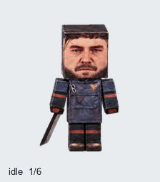
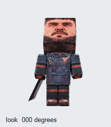
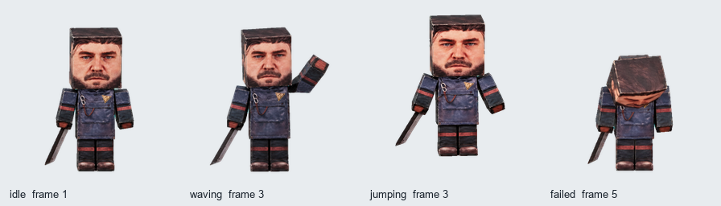

# 迪伦·法登纸偶 Codex Pet

迪伦被折成纸偶之后，还得陪我写代码。脸很严肃，动作很搞怪 🤣

根据《控制：共振》（Control Resonant）迪伦·法登的官方纸偶图纸和折叠实物照片制作的非官方同人 pet。保留了方块大头、写实印刷面孔、深色制服，以及右手里的长条武器。

**9 种动作 · 16 个视线方向 · 73 帧 · 透明背景**

| 日常动作 | 东张西望 |
| :---: | :---: |
|  |  |

## 下载

- **[下载完整素材包](https://github.com/YuXingyao000/dylan-faden-codex-pet/releases/latest/download/dylan-faden-pet.zip)**
- [下载透明 PNG 图集](https://raw.githubusercontent.com/YuXingyao000/dylan-faden-codex-pet/main/assets/dylan-faden-v2.png)
- [观看 MP4 动画](previews/all-states.mp4)

## 怎么用

下载素材包，使用 `assets/dylan-faden-v2.png` 作为 pet 图集。它采用 Pets v2 的 **1536 × 2288** 布局，单帧 **192 × 208**。

如果你的 Codex / ChatGPT 环境已连接支持图集导入的 Pets 工具，可以上传这张 PNG，并告诉它：

> 请使用这张现成图集创建一个名为「迪伦·法登」的 pet。图集已经是 v2 布局，请保留原图，验证后导入，无需重新绘制。

客户端是否支持自定义 pet，以及具体导入入口，以你使用的版本为准。`pet.json` 是本仓库提供的动画说明清单，供读取帧序列使用，并非客户端安装配置。

## 他会干什么

待机眨眼、向右跑、向左跑、挥手、小跳、低头受挫、摊手等你、摸下巴思考，以及歪头检查结果。

跳跃衔接也单独做了预览：[待机 → 小跳 → 待机](previews/idle-jump-idle.gif)。各动作的独立 GIF 在 [previews/states](previews/states)，完整帧排布见 [接触表](previews/contact-sheet.png)。

## 制作与格式

使用内置 imagegen 生成基础造型和动作条，再分帧、去背景、对齐和组装。原图集已通过尺寸、透明度、帧数、跳跃与视线检查，并成功导入为自定义 pet。

- [图集布局与帧时长](docs/sprite-format.md)
- [制作思路和提示词](docs/making-of.md)
- [检查结果摘要](validation-summary.json)

其中少量中间视线的变化比较细微，尤其接近正下方的 157.5°；四个主要方向已通过独立复核。

## 来源

角色与原始纸偶设计来自 Remedy Entertainment 的《Control Resonant》。本项目是玩家制作的非官方同人作品，与官方无隶属关系。相关角色、名称与原始美术的权利归各自权利人所有。

---

An unofficial Dylan Faden papercraft companion inspired by Control Resonant. Nine animation states and sixteen gaze directions, packaged as a transparent Pets v2 sprite sheet.
